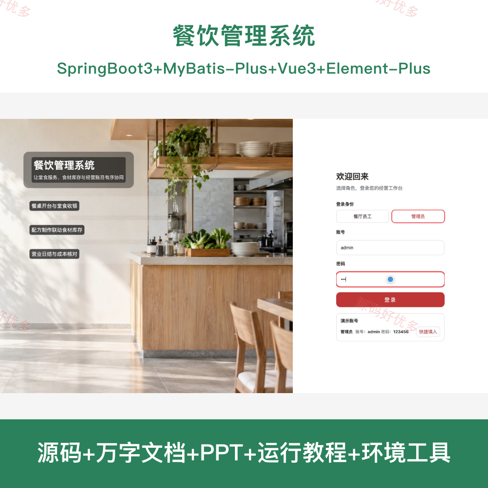
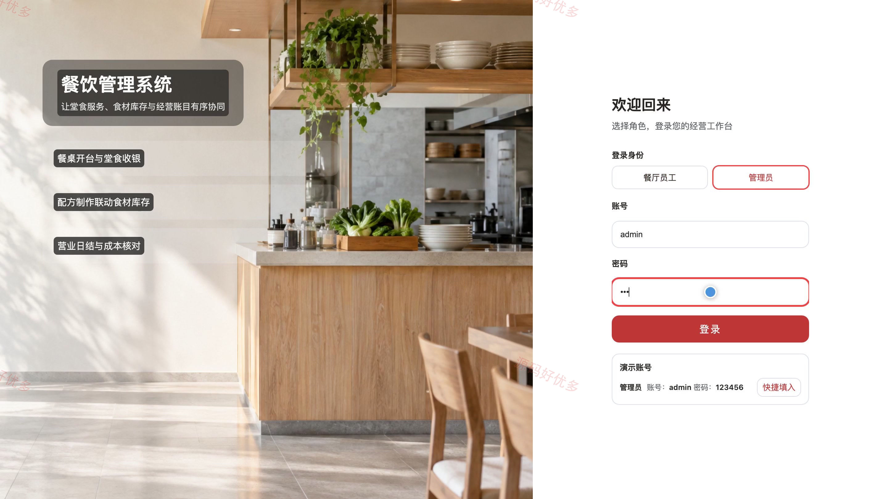
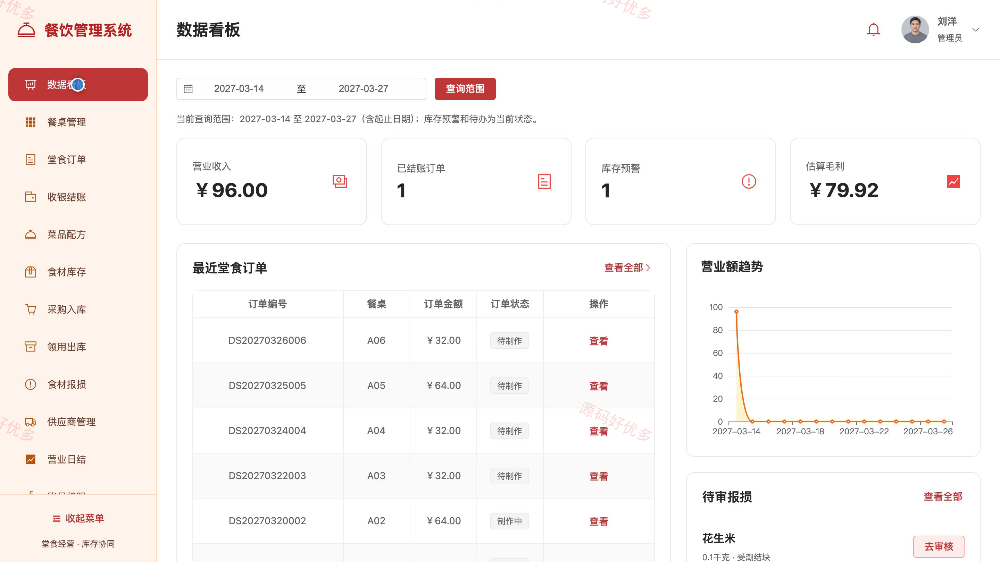
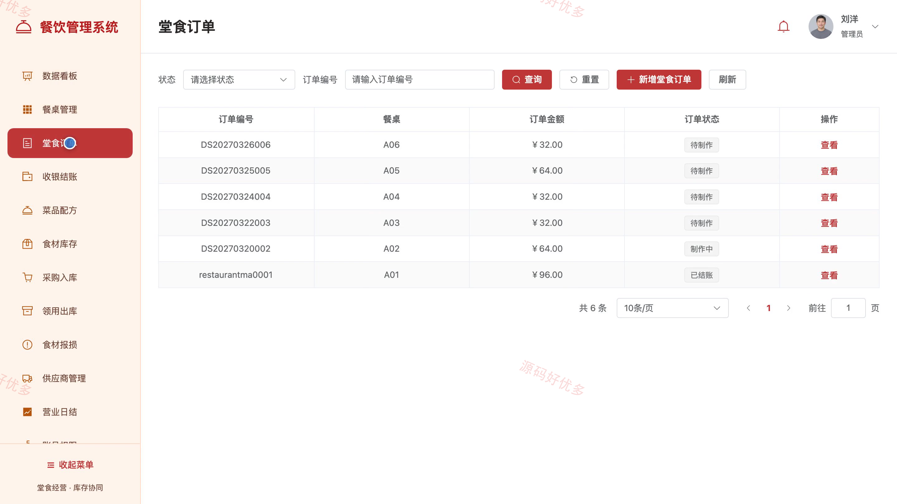
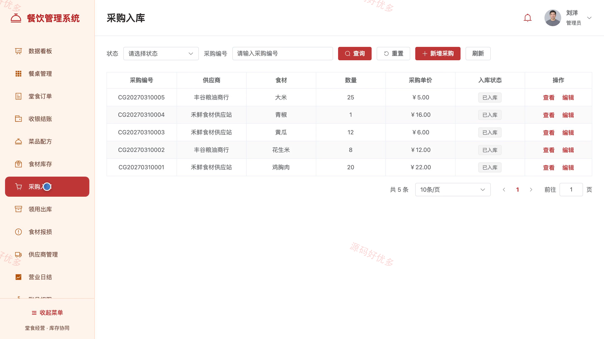
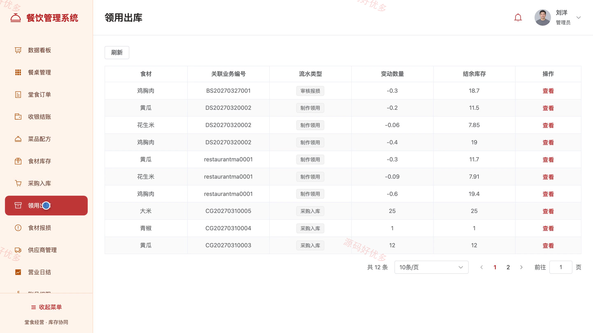
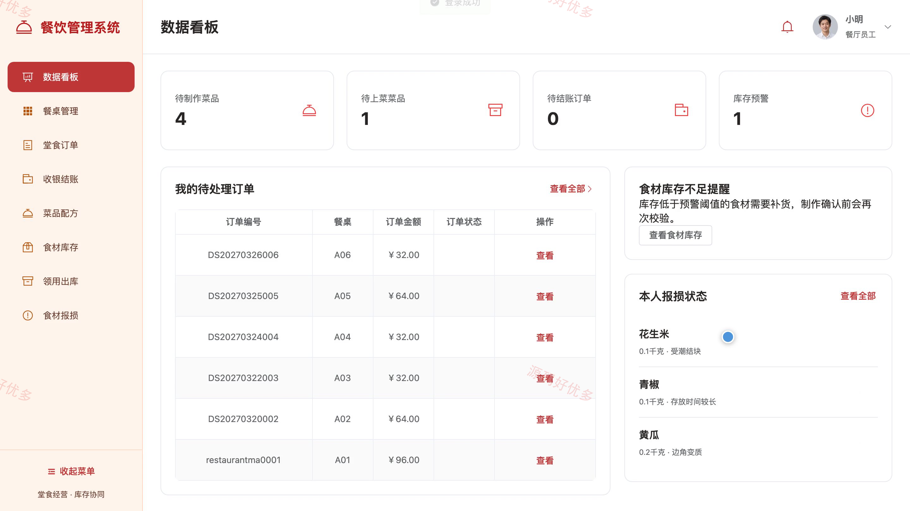
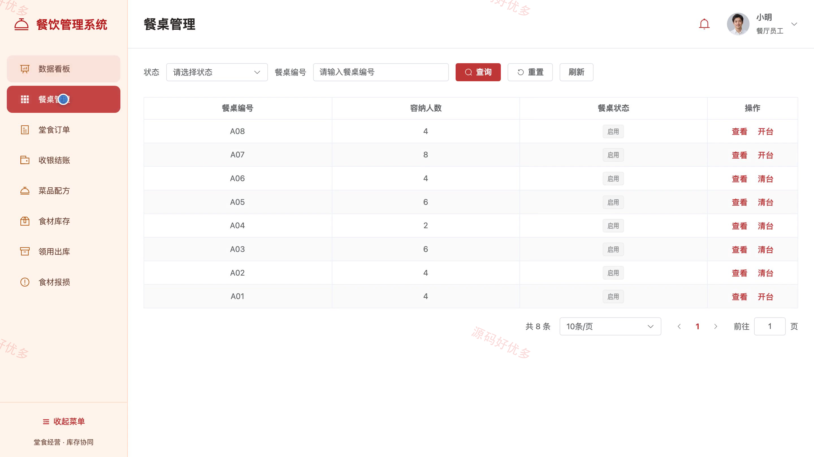
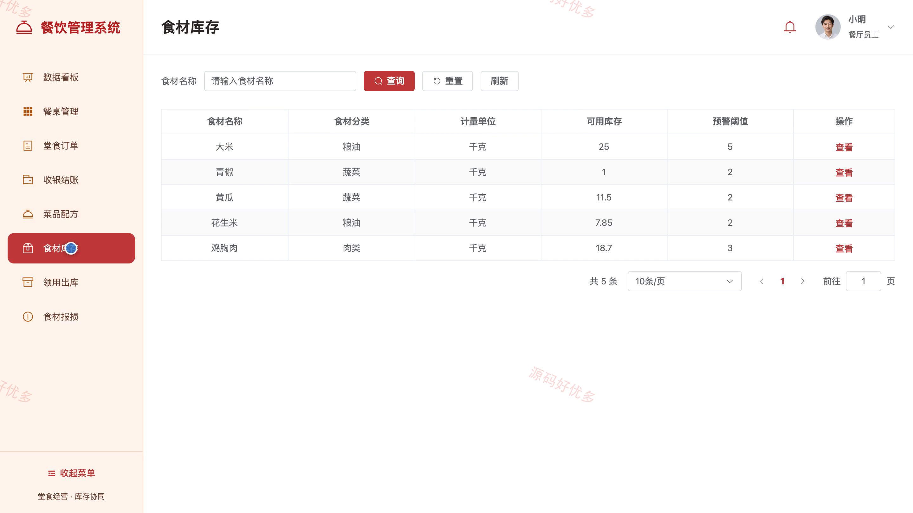

# bs150A
bs150A餐饮管理系统源码 Java SpringBoot3 Vue3 前后分离 设计文档 PPT
## 源码问题查看主页咨询

### 一、关键词
餐饮管理、堂食点餐、餐厅收银、食材库存、餐饮进销存

### 二、作品包含
源码+数据库+万字设计文档+PPT+全套环境和工具资源+本地部署教程

### 三、项目技术
前端技术： Html、Css、Js、Vue3.4、Element-Plus
后端技术：Java、SpringBoot3.2.0、MyBatis-Plus

### 四、运行环境要求
开发工具：IDEA/eclipse + VSCODE

数据库：MySQL5.7+（共15张表）

数据库管理工具：Navicat10以上版本

环境配置软件： JDK17 + Maven3.6

前端Nodejs：20

浏览器：谷歌浏览器

### 五、项目介绍
项目编号：bs150A

面向餐厅堂食经营，餐厅员工通过管理端处理餐桌开台、堂食订单、收银结账和食材出入库；管理员还可管理采购、供应商、账号权限及营业日结。

角色：餐厅员工、管理员

餐厅员工功能：查看堂食数据看板、维护菜品配方与餐桌、处理堂食订单、收银结账、查看食材库存、登记领用出库与食材报损。

管理员功能：查看堂食数据看板、管理菜品配方与餐桌、监管堂食订单与收银结账、管理食材库存和采购出库、审核食材报损、管理供应商、核对营业日结、管理账号权限。

### 六、运行截图

